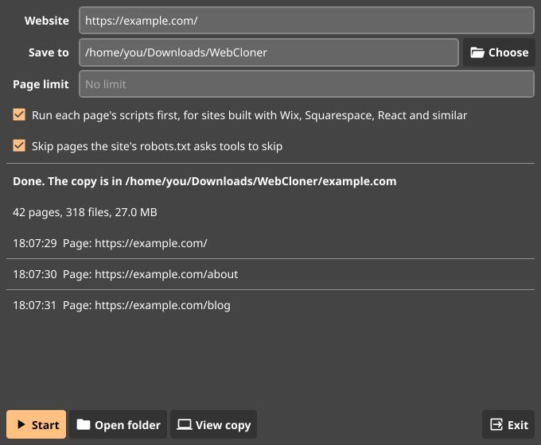

# WebCloner

WebCloner copies a website to a folder on your computer. You type the address, pick a folder, and press Start. It runs on Linux, macOS and Windows, and everything happens on your own machine. There's no account and no server in between.



The copy opens straight from the folder (double-click `index.html`), and you can upload that folder to any static web host to move a site off a site builder.

## Install

**Linux and macOS**, in a terminal:

```sh
curl -fsSL https://raw.githubusercontent.com/grangedevgroup-code/WebCloner/main/install.sh | sh
```

On Linux this installs the `.deb`, `.rpm` or pacman package with your package manager (it asks for your password through `sudo`), which also brings in the few system libraries WebCloner needs. Add `-s -- --user` after `sh` to put it in `~/.local` without `sudo` instead. On macOS it copies WebCloner into Applications.

**Windows**, in PowerShell:

```powershell
irm https://raw.githubusercontent.com/grangedevgroup-code/WebCloner/main/install.ps1 | iex
```

That installs WebCloner for your user account and adds it to the Start menu and to Installed apps, where you can uninstall it.

To remove WebCloner later, run `curl -fsSL https://raw.githubusercontent.com/grangedevgroup-code/WebCloner/main/install.sh | sh -s -- --uninstall` on Linux or macOS, or uninstall it from Settings on Windows.

### Downloads

Every release on the [Releases page](https://github.com/grangedevgroup-code/WebCloner/releases/latest) has:

| System | Files |
| --- | --- |
| Windows 10 and 11 (64-bit) | `WebCloner-windows-amd64.msi` installer, or `WebCloner-windows-amd64.zip` with a portable `WebCloner.exe` |
| macOS 11 and newer (Apple silicon and Intel) | `WebCloner-macos.dmg` or `WebCloner-macos.zip` |
| Debian, Ubuntu, Mint, Pop!_OS | `webcloner_<version>-1_amd64.deb` or `_arm64.deb` |
| Fedora, RHEL, Alma, Rocky, openSUSE | `webcloner-<version>-1.x86_64.rpm` or `.aarch64.rpm` |
| Arch, Manjaro, EndeavourOS, CachyOS | `webcloner-<version>-1-x86_64.pkg.tar.zst` (install with `sudo pacman -U`) |
| Any other Linux | `WebCloner-linux-amd64.AppImage` or `WebCloner-linux-amd64.tar.xz` (and `arm64` versions) |

The Linux builds need glibc 2.27 or newer, so they run on Ubuntu 18.04, Debian 10, RHEL 8 and anything released since. Alpine and other musl-based systems aren't supported yet.

The Windows and macOS apps aren't signed yet. When you download them in a browser, Windows SmartScreen may say it protected your PC; click **More info** and then **Run anyway**. On macOS, right-click WebCloner and choose **Open** the first time. The install commands above avoid both prompts.

## Using it

1. Type the website address, for example `example.com`. Typing `https://` is optional.
2. Pick where the copy goes with **Choose**. WebCloner makes a folder named after the site inside it.
3. Press **Start**. The button turns into **Stop**, which ends the copy early. Pages that were already saved keep working links either way.
4. When it finishes, **Open folder** shows the files and **View copy** opens the copied home page in your browser. **Exit** closes the app.

WebCloner remembers the last address and folder.

### Options

**Page limit** stops after that many pages. Leave it empty to copy every page it can reach.

**Run each page's scripts first** loads every page in a hidden Chrome, Edge, Brave or Chromium window before saving it, so pages built by JavaScript (Wix, Squarespace, Webflow, React apps and similar) are saved the way they look in a browser. Their scripts are then left out of the copy, and entrance animations are frozen in their finished state. The option is greyed out if none of those browsers is installed. Turn it off for plain HTML sites; that's faster and keeps the site's own scripts.

**Skip pages the site's robots.txt asks tools to skip** follows the site's `robots.txt`.

## What gets copied

WebCloner follows links between pages on the same site, including the `www.` and bare-domain versions of the address. For each page it also saves the images, stylesheets, fonts, icons, videos and scripts it uses, including files on other hosts such as CDNs. Those go in an `_external` folder inside the copy. All links are then rewritten to point at the local files. Links to pages that weren't copied (other sites, pages past the limit, pages that failed) point to the live site instead.

Page addresses become folders. `example.com/about` is saved as `about/index.html`, so the copy keeps clean addresses on most web hosts. File names that Windows or macOS can't store are adjusted.

## Limits

Forms, shopping carts, logins, search and anything else that needs the original server won't work in the copy. Content a page loads only after a click, such as menus or galleries, is saved as it looked when the page first loaded. Canvas drawings and videos that a site shows only through its scripts can be missing when the scripts are left out. Only copy sites you own or have permission to copy.

## Command line

Running WebCloner with arguments copies a site without opening the window:

```sh
webcloner -url https://example.com -out ~/Sites -pages 50
```

`webcloner -help` lists the options (`-js=false` and `-robots=false` turn those options off). On Windows the command-line mode prints nothing, because `WebCloner.exe` is built as a windowed app.

## Building from source

You need Go (the version in `go.mod`) and a C compiler. On Linux, also install the OpenGL and X11 headers, for example on Debian or Ubuntu:

```sh
sudo apt install gcc libgl1-mesa-dev xorg-dev libwayland-dev libxkbcommon-dev
```

Then:

```sh
go test ./...
go build -o webcloner .
```

To make a packaged app the way the releases do, install the Fyne tool (`go install fyne.io/tools/cmd/fyne@latest`) and run `fyne package --release`.

Releases are built by GitHub Actions when a `v*` tag is pushed. The tag has to match `Version` in `FyneApp.toml`.

## License

MIT. See [LICENSE](LICENSE).
